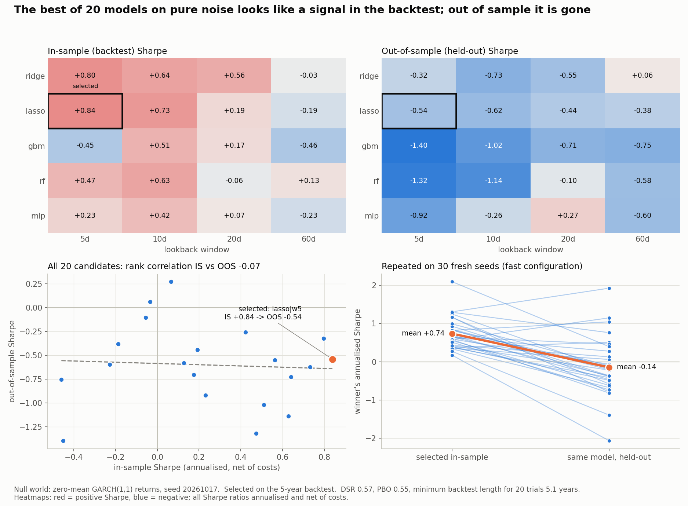

# Case study: the best of 20 models on pure noise

The [first four case studies](../zero-dte-audit.md) pointed the toolkit at strategies where something
was going on: a bug, a weak edge, a false execution assumption, a ride too rough to sit through. This one
removes the something. It runs a researcher's ordinary model search on a market where **nothing is
predictable by construction**, and asks what the search reports and what the toolkit says about it.
Every "winner" here is false; the only question is how convincing it looks.

The design was pre-registered before any result ([DESIGN.md](DESIGN.md)); this is the reduced
null-world slice of it, and the reductions are logged there under "Amendments".

## The setup

- **The null world.** A seeded price series: GARCH(1,1) volatility with symmetric fat-tailed
  innovations and **exactly zero conditional mean**. Volatility clusters, like a real index, but the
  direction of the next return is independent of everything before it. Every candidate's true Sharpe
  before costs is zero.
- **The search.** 5 model families (ridge, lasso, gradient boosting, random forest, a one-hidden-layer
  MLP) x 4 lookback windows (5, 10, 20, 60 days) = 20 candidates. Each is fitted walk-forward (expanding
  window, refit every 21 trading days) on the last `w` daily returns, and traded as sign(prediction)
  with 1 bp/side costs. Everything at day *t* uses data up to *t* only (a test rewrites the future and
  checks nothing earlier moves).
- **The split.** The first 5 years of the walk-forward stream are the researcher's backtest: the model
  is selected, and DSR / PBO / MinBTL computed, on those days alone. The next 3 years are held out and
  only used to see what the selected model does.

## The audit

All 20 candidates (annualised Sharpe, net of costs; in-sample / out-of-sample):

| model | 5d | 10d | 20d | 60d |
|---|---|---|---|---|
| ridge | +0.80 / -0.32 | +0.64 / -0.73 | +0.56 / -0.55 | -0.03 / +0.06 |
| lasso | **+0.84** / -0.54 | +0.73 / -0.62 | +0.19 / -0.44 | -0.19 / -0.38 |
| gbm | -0.45 / -1.40 | +0.51 / -1.02 | +0.17 / -0.71 | -0.46 / -0.75 |
| rf | +0.47 / -1.32 | +0.63 / -1.14 | -0.06 / -0.10 | +0.13 / -0.58 |
| mlp | +0.23 / -0.92 | +0.42 / -0.26 | +0.07 / +0.27 | -0.23 / -0.60 |

Selecting the best backtest and running the toolkit on the search:

```
best in-sample model:             lasso, 5-day window
best annual Sharpe (in-sample):   +0.84   (t = 1.88)
same model, held-out 3 years:     -0.54   (rank 8 of 20; only 2 of 20 candidates positive)
Probabilistic Sharpe (vs 0):      0.970   (a naive test says "significant")
Deflated Sharpe (DSR):            0.57    (want > 0.95; best-of-20 luck benchmark 0.76)
PBO (CSCV, 16 splits):            0.55    (want < 0.50)
P(OOS loss of IS-best):           0.40
IS->OOS degradation slope:        -0.63
min backtest length for N=20:     5.1 years  (sample: 5.0)
VERDICT: OVERFIT
```

Is that one draw representative? The same search repeated on 30 fresh seeds (a shorter, lighter
configuration: 3-year backtest, quarterly refits, smaller ensembles) gives:

```
in-sample winner positive:        30 / 30 seeds   (mean Sharpe +0.74)
winner out-of-sample, gross:      0.00 (SE 0.14)
winner out-of-sample, net:        -0.14 (SE 0.14)   positive in 10 / 30 seeds
DSR < 0.95:                       30 / 30 seeds   (median 0.33)
winner t > 2 in-sample:           6 / 30 seeds    -> DSR rejected all 6
PBO:                              mean 0.54, >= 0.5 in 18 / 30 seeds
verdict:                          OVERFIT 18 / 30, "suspect" 12 / 30, never "survives"
```

## What this shows

1. **A best model emerges every time.** Nobody put a signal in, and the best of 20 candidates
   is positive in all 30 replications and comfortably so on average (+0.74 Sharpe). In the headline run 14 of
   20 candidates are positive in-sample and the top three are all +0.7 or better. Reporting only that
   row would be a publishable-looking result.
2. **None of it carries forward.** Held out, the selected model lost money (-0.54), and across the 20
   candidates the in-sample rank has no relation to the out-of-sample rank (Spearman -0.07). The
   replication pins the expectation: the winner's out-of-sample Sharpe is zero before costs and
   slightly negative after. This particular held-out stretch was unkind to nearly every candidate
   (mean -0.60), which is chance, not a finding.
3. **Deflation sees it.** The winner's Sharpe passes a naive significance test (PSR 0.970) and fails
   the deflated one (DSR 0.57): +0.84 is barely above the +0.76 you expect from the luckiest of 20 noise
   strategies. DSR rejected the winner in every replication, including all six seeds where the winner
   cleared the usual t > 2 bar.
4. **PBO is a coin flip on noise, not a conviction.** On pure noise PBO should sit near 0.5: the
   in-sample rank tells you nothing about the out-of-sample rank. That is what it reports: 0.55 here, mean
   0.54 over the seeds. But any single run lands on either side of 0.5, so PBO alone would have convicted
   only 18 of 30 seeds. DSR did the catching; the two together never let a false winner through (no seed had DSR >= 0.95
   with PBO < 0.5).
5. **The sample was too short for 20 trials.** Minimum backtest length for 20 trials at a Sharpe of 0.84
   is 5.1 years against 5.0 available: before any deflation arithmetic, the backtest was too short to
   tell this Sharpe from luck.

## Limits

One simulated asset and 20 candidates, not the 360 per asset in the full design; the real-data world,
the effective-trial count and the Romano-Wolf / SPA / Benjamini-Hochberg comparisons are not built, so this
says nothing about how the corrections perform on real returns. DSR here counts 20 trials, but the
candidates all see the same returns and are not 20 independent ones. The 30-seed replication uses the
lighter configuration, so its numbers are a check on the headline, not a restatement of it.

## Reproduce

```
pip install -r requirements.txt     # numpy, scipy, scikit-learn, matplotlib, pytest
python case_studies/ml_model_search/run_search.py
```

About two minutes on a laptop. The seed is fixed (20261017), so the run is reproducible to the printed
digits; `results.json` holds every number above and `results.png` the figure.


